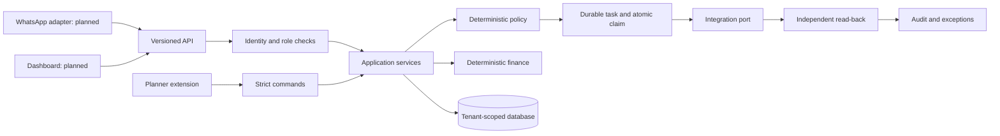

# Architecture

## Decision

Use a modular monolith first: a versioned FastAPI interface, typed Pydantic commands, separate application services, deterministic policy and finance, transactional persistence, and provider/planner ports. One deployable backend keeps contribution and local setup simple. Split services only for demonstrated scaling or isolation needs. No model is trusted to authorize actions.

## Code boundaries

| Module | Responsibility |
|---|---|
| api | HTTP validation, authentication and role dependencies, OpenAPI |
| domain | Immutable commands and pure financial calculations |
| services | Tenant-scoped use cases, transaction orchestration and state transitions |
| policy | Default-deny permissions; model-independent decisions |
| database | Connection lifecycle, local schema and constraints |
| integrations | Provider execution/read-back and planner contracts |
| cli | Operator-controlled tenant/key provisioning and revocation |

## Execution guarantees and limits

Unique tenant/idempotency key plus payload hash prevents changed command replay. Atomic database claim prevents concurrent submission of the same task. Provider calls run outside the transaction. Reference evidence is saved before verification. Timeouts become uncertain and never resubmit automatically. There is no exactly-once guarantee across a database and external API: crash after submission may leave running tasks. These need operator/provider reconciliation, then a future leased worker with a durable outbox. No blind retry is shipped.

Policy is read during claim. Revocation blocks subsequent claims; an already running request may complete. Stronger cancellation requires provider support and execution coordination. Plugins are trusted server-side code, not an untrusted-code sandbox. They cannot be supplied through the public API.

## Production target

PostgreSQL with forced tenant row-level security and composite foreign keys; OIDC membership/RBAC; vault-backed encrypted credentials; queue workers with leases/outbox/dead letters; S3-compatible media quarantine; raw-body signed webhook inbox; structured redacted logs, traces and metrics; backup/restore and retention policies. These are designed next steps, not deployed components.

Media ingestion, conversational context, provenance records, reconciled orders, notifications and dashboard become separate bounded modules using the same tenant and action contracts. Planning/forecasting follows validated data collection and baseline evaluation.
